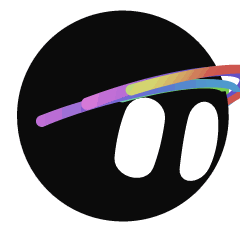
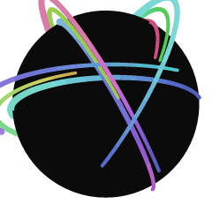
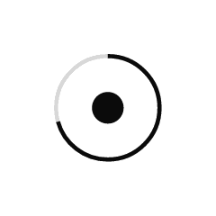
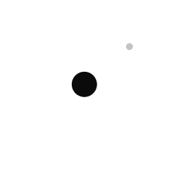

# State preview gallery / 状态预览图廊

Looping animated previews of every `<morph-bot>` state — 16 emotional
reactions and 23 functional/agent states (39 total). Each GIF was rendered
**offline from this project's own component**, so the previews stay in sync
with the real runtime rather than being hand-drawn.

> 这里是全部 `<morph-bot>` 状态的循环动图预览——16 个情绪反应 + 23 个功能 / Agent
> 状态，共 39 个。每张 GIF 都是用项目**自带的组件离线渲染**出来的，和真实运行时保持一致，
> 并非手绘。

## Reactions / 情绪反应

| | | | |
|:-:|:-:|:-:|:-:|
| <br>Happy 开心 | <br>Laughing 大笑 | <br>Excited 兴奋 | <br>Surprised 惊讶 |
| <br>Angry 生气 | <br>Sad 难过 | <br>Shy 害羞 | <br>Curious 好奇 |
| <br>Confused 困惑 | <br>Bored 无聊 | <br>Proud 得意 | <br>Suspicious 怀疑 |
| <br>Scared 害怕 | <br>Playful 调皮 | <br>Drowsy 困倦 | <br>Celebrate 庆祝 |

## Lifecycle / 基础状态

| | | | |
|:-:|:-:|:-:|:-:|
| <br>Idle 待机 | <br>Sleeping 睡眠 | <br>Waking 醒来 | <br>Listening 倾听 |
| <br>Thinking 思考 | <br>Searching 搜索 | <br>Working 工作 | |

## Agent morphs / Agent 形变

| | | | |
|:-:|:-:|:-:|:-:|
| <br>Orbit 轨道 | <br>Radar 雷达 | <br>Progress 进度 | |

## Product lifecycle / 任务状态

| | | | |
|:-:|:-:|:-:|:-:|
| <br>Spawning 生成 | <br>Humming 运转 | <br>Loading 加载 | <br>Dictating 听写 |
| <br>Writing 书写 | <br>Sending 发送 | <br>Receiving 接收 | <br>Uploading 上传 |
| <br>Notifying 通知 | <br>Alerting 警报 | <br>Dragging 拖拽 | <br>Bouncing 弹跳 |
| <br>Powering down 关机 | | | |

## How these were generated / 如何生成

`build-gifs.mjs` drives the real animation engine headlessly and encodes each
state to a looping GIF — **no browser and no ffmpeg**:

1. **jsdom** mounts a `<morph-bot>` element and runs the actual
   `grok-bot-engine` with a manually-stepped animation clock (stubbed
   `requestAnimationFrame` / `performance.now`), so frames are deterministic.
2. Each frame's live SVG is serialized and rasterized to RGBA with
   **`@resvg/resvg-js`** (a strict Rust SVG renderer, not a browser).
3. **`gifenc`** quantizes the frames and assembles a looping GIF
   (240 px, 20 fps, ~2.5 s per loop, white background).

> `build-gifs.mjs` 以无头方式驱动真实动画引擎，把每个状态编码成循环 GIF——**不依赖浏览器，
> 也不依赖 ffmpeg**：jsdom 挂载 `<morph-bot>` 并用手动步进的时钟跑真实 `grok-bot-engine`
> （桩掉 `requestAnimationFrame` / `performance.now`，保证逐帧确定性）→ 每帧的实时 SVG 用
> `@resvg/resvg-js` 光栅化 → `gifenc` 量化合成循环 GIF（240px、20fps、单循环约 2.5 秒、白底）。

### Reproduce / 复现

```bash
# from the repo root
npm install --no-save jsdom@24 @resvg/resvg-js gifenc
node previews/build-gifs.mjs                 # the 16 reactions (default set)
node previews/build-gifs.mjs idle,thinking   # or any comma-separated state ids
```

State ids are the ones defined in [`component/catalog.js`](../component/catalog.js).
The three render dependencies are **not** added to the project's
`package.json` — install them transiently with `--no-save` only when
regenerating the gallery.

> 状态 id 见 [`component/catalog.js`](../component/catalog.js)。三个渲染依赖**不会**写进项目的
> `package.json`——仅在重新生成图廊时用 `--no-save` 临时安装。
